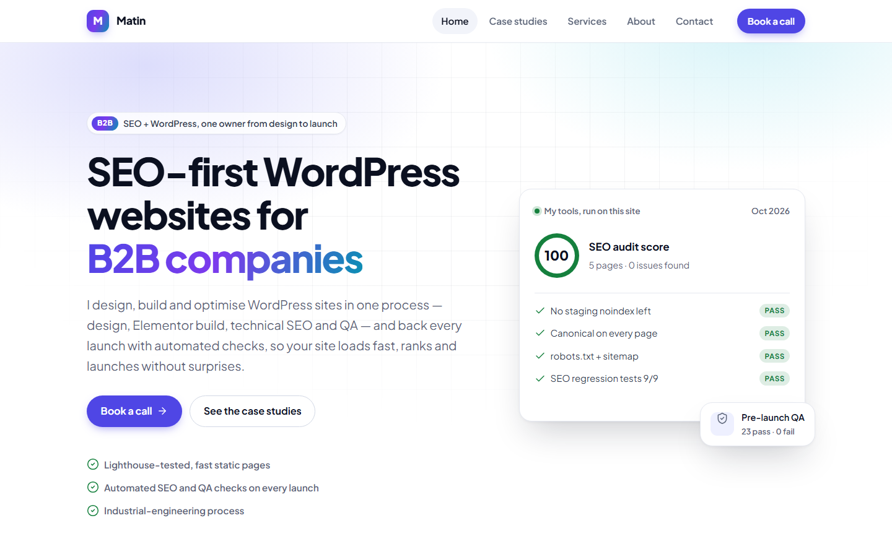
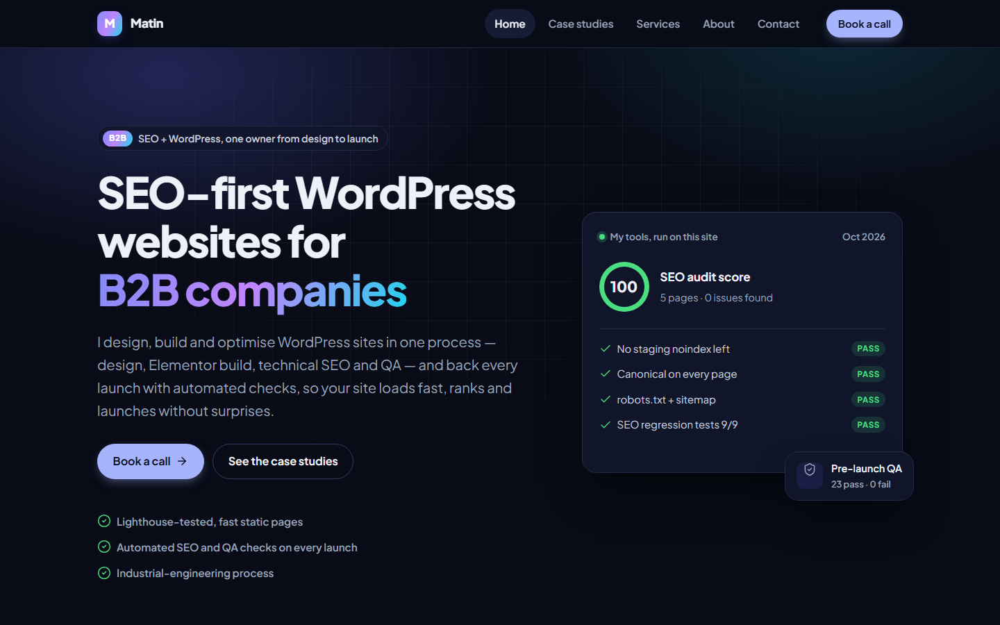
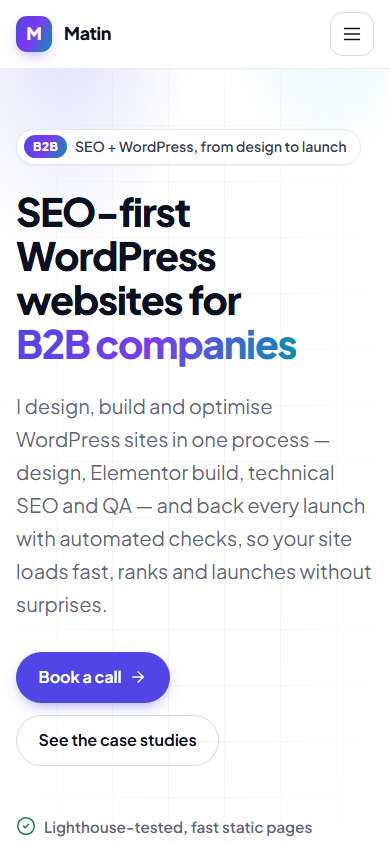

# P15 — Personal portfolio site without WordPress

> **Status:** Live (only Git branch practice left) · **Priority:** Must · **Build order:** 1 of 40 · **Estimate:** 5 days
> Personal / demo project — not client work.

## Problem
Platform profiles (Upwork, LinkedIn) are not yours. You need one fast, owned home for every case study.

## How it works
A static Astro site. Each case study is a Markdown file; Astro builds static pages served from a CDN, so Core Web Vitals stay above 90.

## Design


| Dark theme | Phone |
|---|---|
|  |  |

- **Tokens first:** every colour, type size, space, radius and shadow is a CSS custom property at the top of `site/src/styles/global.css`, with a full dark theme that follows the visitor's system setting.
- **Type:** Plus Jakarta Sans (variable font, self-hosted). Only the 27 KB Latin file is loaded and preloaded; `font-display: swap` keeps text visible while it loads.
- **Brand:** calm neutral base with one indigo → violet → cyan gradient accent (logo mark, hero highlight, feature card border, call-to-action band).
- **Components** (`site/src/components/`): `Header` (sticky, blurred, accessible phone menu: `aria-expanded`, closes on Escape; without JavaScript the links simply wrap), `Footer`, `CaseStudyCard` (whole card clickable, metric chips), `CtaBand`, `Icon` (inline Lucide SVG icons, no icon font).
- **Honest proof:** the hero panel shows real results of my own tools run on this site (P6 audit, P13 regression tests, Q1 QA) with the date of the run.
- **Accessibility:** skip link, visible focus rings, AA contrast in both themes, `prefers-reduced-motion` respected.

## Tech stack
- Astro
- HTML/CSS (no CSS framework)
- Markdown
- Git + GitHub
- GitHub Pages + GitHub Actions

## Project structure
```
01-P15-portfolio-site/
├── .github/workflows/deploy.yml
├── content-templates/
│   └── case-study.md          # front matter for new case studies
├── design/
│   ├── og-image.html          # source of site/public/og-image.png
│   └── make-icons.mjs         # builds apple-touch-icon.png + favicon.ico from favicon.svg
├── results/                   # Lighthouse runs and screenshots of the design
├── site/
│   ├── public/                # favicons, og-image.png, robots handled in src/pages/robots.txt.ts
│   ├── scripts/check-seo.mjs  # SEO checks on every built page (also runs in CI)
│   └── src/
│       ├── components/        # Header, Footer, CaseStudyCard, CtaBand, Icon
│       ├── content/case-studies/   # one Markdown file per case study
│       ├── layouts/BaseLayout.astro
│       ├── lib/               # case-study sorting, stage labels
│       ├── pages/             # home, services, about, contact, case studies, 404, robots.txt
│       ├── styles/global.css  # the design system
│       └── site.ts            # name, email, profiles, Search Console code - edit here only
├── .gitignore
├── CLAUDE.md
└── site-plan.md
```

## Setup
Requires Node.js 22.12+.

```bash
npm create astro@latest site
cd site
npm run dev
```
The Astro project lives in `site/`; planning files stay at the root. `.github/workflows/deploy.yml` builds `site/`, runs the SEO check and publishes to GitHub Pages on every push to `main`.

## Usage
```bash
cd site
npm run dev      # local preview
npm run build    # production build in site/dist
npm run check    # SEO checks on every built page (run after build)
```

## Build checklist
- [ ] Learn Git basics first: init, add, commit, push, branch (2 days)
- [x] Run `npm create astro@latest site` (minimal template); the Astro project lives in `site/`
- [x] Write site-plan.md: pages, menu, one-line positioning
- [x] Add a case-study content collection using content-templates/case-study.md
- [x] Add SEO basics: title/meta per page, sitemap, robots.txt, Person + ProfessionalService schema
- [x] Build the pages from site-plan.md (case-study list + detail, services, about, contact) on BaseLayout
- [x] Deploy to GitHub Pages (https://matt-g20.github.io) via GitHub Actions
- [ ] Later: buy a domain, connect it and update `site` in astro.config.mjs
- [x] Site styling: one global stylesheet with design tokens (colours, type, spacing), responsive header menu
- [x] Full home page: services summary, featured case studies, call to action
- [x] 404 page and default Open Graph image
- [x] Re-measure Lighthouse on mobile after styling and update Results
- [x] Redesign (2026-10-19): design tokens with dark mode, self-hosted variable font, components, hero with real tool results, case-study model with date/tools/metrics, new OG image and favicons
- [ ] Personal details — TODO (Matin): in `site/src/site.ts` paste your LinkedIn and Upwork URLs, add a square photo to `site/public/` and set `PHOTO`, and paste the Search Console verification code into `GOOGLE_SITE_VERIFICATION`; then commit and push

## Results
Lighthouse mobile on the live site with full design (2026-10-12, median of 3 runs): Performance 100, Accessibility 100, Best Practices 100, SEO 100 · LCP 1.3 s, CLS 0, TBT 30 ms. Live at https://matt-g20.github.io.
