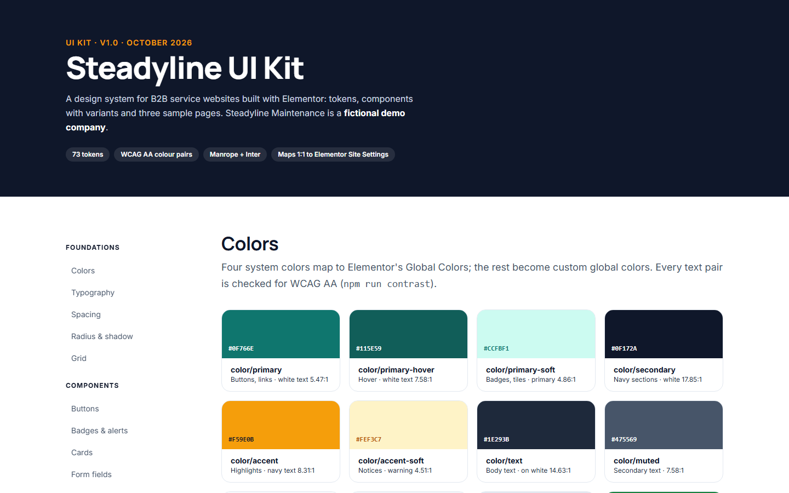

## Problem
Every new B2B website started from a blank page: colours picked again, type sizes guessed, buttons rebuilt. Designs were slow and inconsistent, and the Elementor build drifted from the design because nothing linked the two.

## Approach
1. Every design decision became a token in one file (W3C Design Tokens format): 16 colours, 2 font families, a 9-step type scale with mobile sizes, spacing, radii, shadows and layout widths — 73 tokens.
2. A script checked every text/background colour pair against WCAG AA **before** any design work.
3. CSS is generated from the tokens, so the coded kit can't drift from them.
4. Components with all variants and states — buttons (4 variants × 3 sizes × 4 states), badges, alerts, cards, header, footer, form fields, accordion — named as they are in Figma.
5. Three sample pages for a fictional maintenance company, built only from those components.
6. Every token mapped to its place in Elementor's Site Settings, which the WordPress kit (W1) applies automatically.

## Key decisions
- **Tokens before screens** — colours and type decided once, as data, make a rebrand a one-file change in Figma, CSS and Elementor at the same time.
- **Elementor's four system colours = the four brand roles** (primary, secondary, text, accent); everything else is a named custom colour, so widgets pick colours by name, never by hex code.
- **No fake social proof** — logos, quotes and numbers are visibly placeholders until a real client approves real content.

## Results
| Measurement | Result |
|---|---|
| Design tokens | **73**, in one W3C tokens file |
| Text/background pairs passing WCAG AA | **17 / 17** |
| Components | 12 groups, incl. 48 button combinations |
| Sample pages | 3, responsive from 360 to 1440 px |
| Mapped to Elementor | every colour, font and type style, plus layout, buttons and form fields |

## Lessons
- Generating the Elementor mapping in the same script as the CSS keeps the documentation from drifting; a hand-written table would have been out of date after the first change.
- Placeholders must look like placeholders. Realistic fake logos or numbers in a portfolio are a credibility risk.
