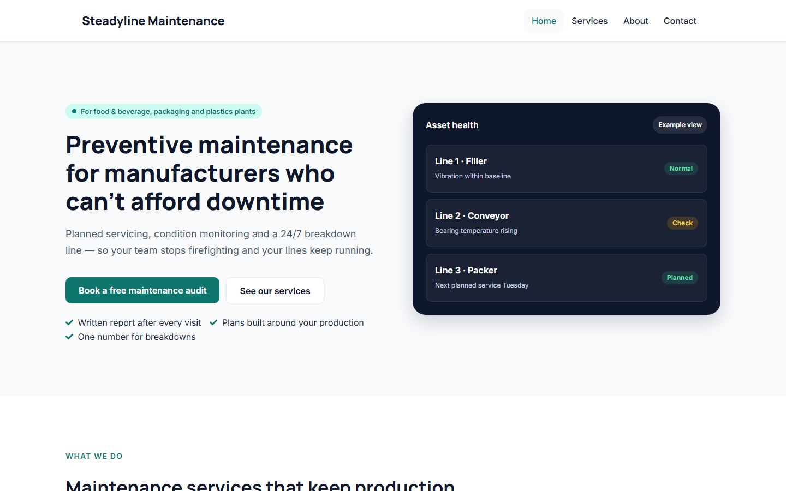

## Problem
B2B service sites are the most common WordPress job, and each one used to start from an empty Elementor install: colours, fonts, headers, forms, schema and speed settings clicked together by hand, slightly differently every time.

## Approach
The kit is **code**, so a new site is one command instead of an afternoon of clicking:

1. **Design tokens from my UI kit** written into Elementor's Site Settings by a script: 4 system + 8 custom colours, 4 global fonts, H1–H6 with mobile sizes, buttons, form fields and layout.
2. **Four page templates** (Home, Services, About, Contact) generated as Elementor JSON, using only global colours and fonts.
3. **One setup script** builds the whole site: plugins, settings, contact form, pages, menu, an SEO/schema must-use plugin and Elementor's speed settings. It can be run again safely and works on real hosting with `wp eval-file`.
4. **Automatic verification**: every run builds a fresh WordPress in [WordPress Playground](https://wordpress.org/playground/) and checks each page like a crawler would.

## Key decisions
- **Code over a kit zip** — a script can be reviewed, versioned, re-run and tested; a zip can only be imported by hand.
- **A small must-use plugin instead of a full SEO plugin** — per-page titles and descriptions plus JSON-LD (ProfessionalService, Service, BreadcrumbList) in about 150 lines.
- **Run setup as an administrator** — Elementor refused to save its settings for a script with no logged-in user; the script now picks an administrator explicitly.

## Results
Measured on a fresh install in WordPress Playground (local, 1 November 2026):

| Check | Result |
|---|---|
| Automated checks | **34 / 34 passed** |
| Per page | 200 status, one H1, title ≤ 60 characters, description 70–155, schema type, Elementor CSS |
| Whole site | unique titles and descriptions, brand colours in the CSS, a real 404 for unknown URLs, no PHP errors or warnings |
| Speed settings, checked in the HTML | no Google Fonts request, no Font Awesome font, no block-editor CSS |

Lighthouse on real hosting comes next: a local WordPress without a page cache doesn't represent production speed.

## Lessons
- **Check settings where they show, not where they are saved.** Two Elementor speed options had been renamed in Elementor 4, so they silently did nothing. The checks now read the page's HTML.
- **Screenshots catch what checks miss.** The first screenshots showed a wrapped hero, an invisible call-to-action band (a lazy-loaded gradient) and an unreadable footer menu — all fixed before release.
- **Test the way a visitor arrives.** Playground's auto-login redirected every request without cookies; removing it made scripts see what visitors see.
