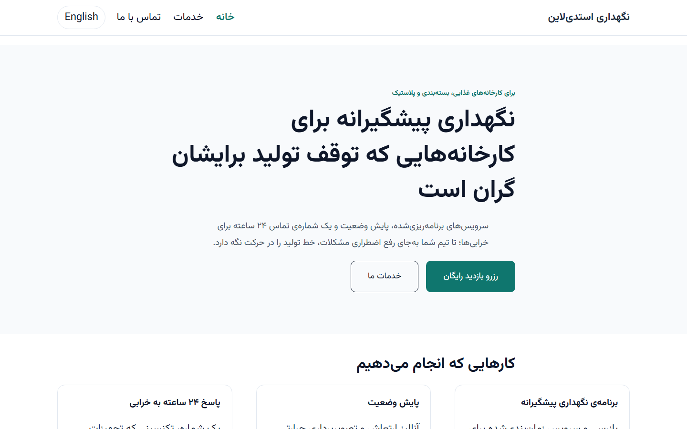

## Problem
Businesses selling in two languages need more than translated text: each page has to point Google to its translation (hreflang), Persian pages need right-to-left layout and Persian typography, and URLs should look native to each audience. My Persian is a real advantage here — if the technical side is right.

## Approach
1. **Plan first**: Polylang (free) — English at the root, Persian under `/fa/` with Persian slugs (`/fa/خدمات/`), and no redirect by browser language, so Google can reach both versions.
2. **Everything as code**: one setup script creates the languages, Home, Services and Contact in both languages, links each pair as translations and sets the front page — tested on a fresh WordPress every run, and usable on real hosting with WP-CLI.
3. **Persian written as Persian**: Persian digits and punctuation, the zero-width non-joiner where words need it, and phone numbers and e-mail addresses isolated as left-to-right text.
4. **RTL done properly in a child theme**: Vazirmatn instead of a random system font, no letter-spacing (it breaks joined Persian letters), no uppercase or italic styling, more line height, logical CSS properties.
5. **An hreflang checker with 9 rules** — status, self-reference, return links, valid codes, x-default, canonical targets, duplicates, `lang`/`dir`, noindex — run on every page and every page they point to.

## Key decisions
- **One domain, a `/fa/` directory** — authority stays in one place, and one Search Console property covers both languages.
- **x-default on every page** — Polylang free adds it only in one special case; a 6-line filter adds it everywhere, pointing to English.
- **The Persian font only where it's needed** — preloaded on Persian pages, never downloaded on English ones.

## Results
Fresh build in a local WordPress (26 October 2026):

| Check | Result |
|---|---|
| hreflang errors (9 rules, 6 pages) | **0** across 18 tags |
| Automated page checks | **11 / 11** — status, one H1, title, description, `lang` and `dir`, Persian font and language switcher on every page |
| Sitemaps | one per language, every page listed |

## Lessons
- **The checker paid for itself on the first run.** It caught the Persian home answering at `/fa/خانه/` instead of `/fa/`. The cause was a Polylang setting whose name suggests something else entirely (`redirect_lang` controls the front-page URL, not visitor redirects).
- **RTL is more than `dir="rtl"`.** WordPress mirrors the layout; Persian typography and mixed-direction text are still the developer's job.
