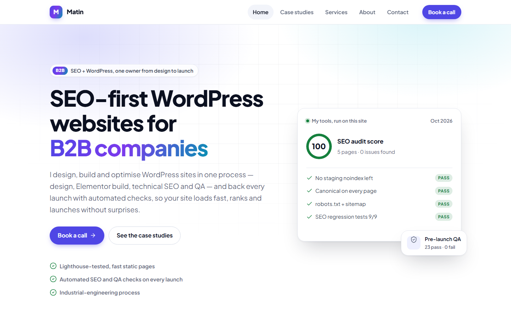

## Problem
Platform profiles (Upwork, LinkedIn) aren't mine, and their pages can't show how I work. I needed one fast, owned home for every case study — itself an example of the SEO and speed I sell.

## Approach
- **Static Astro site on GitHub Pages**, deployed by GitHub Actions on every push.
- **Case studies as Markdown files** checked against a schema at build time: a missing title, a 70-character title or an invented metric field fails the build instead of reaching Google.
- **SEO basics in the layout**: title, description, canonical, Open Graph, sitemap, robots.txt, Person and ProfessionalService schema — and a script that checks every built page.
- **A small design system** with light and dark themes, built from design tokens.

## Key decisions
- **Only numbers from real runs.** The schema allows at most four metrics per case study, and every one comes from a documented run — never an estimate.
- **Drafts can't leak.** Unpublished case studies appear in the local preview only.
- **Measure the fix, not the guess.** When the redesigned home page was slow on a slow CPU, a controlled test (six copies of the page, one feature off in each) showed no single expensive feature: the cost was the first layout of a long page. `content-visibility: auto` on below-the-fold sections cut Total Blocking Time from 281 ms to 107 ms.

## Results
Lighthouse mobile, local preview of the redesign (19 October 2026, median of 3 runs):

| Page | Performance | Accessibility | Best practices | SEO | LCP | Weight |
|---|---:|---:|---:|---:|---:|---:|
| Home | **97** | 100 | 100 | 100 | 1.2 s | 38 KB |
| Case study | **100** | 100 | 100 | 100 | 1.2 s | 36 KB |

The live site is watched every day by my own tools: SEO regression tests (P13) and a Core Web Vitals monitor (P14).

## Lessons
- A slow laptop is a good test device: it shows the CPU cost that a fast desktop hides.
- One Lighthouse run is not a result. The home page scored 91, 97 and 99 in three runs; only the median goes into a case study.
