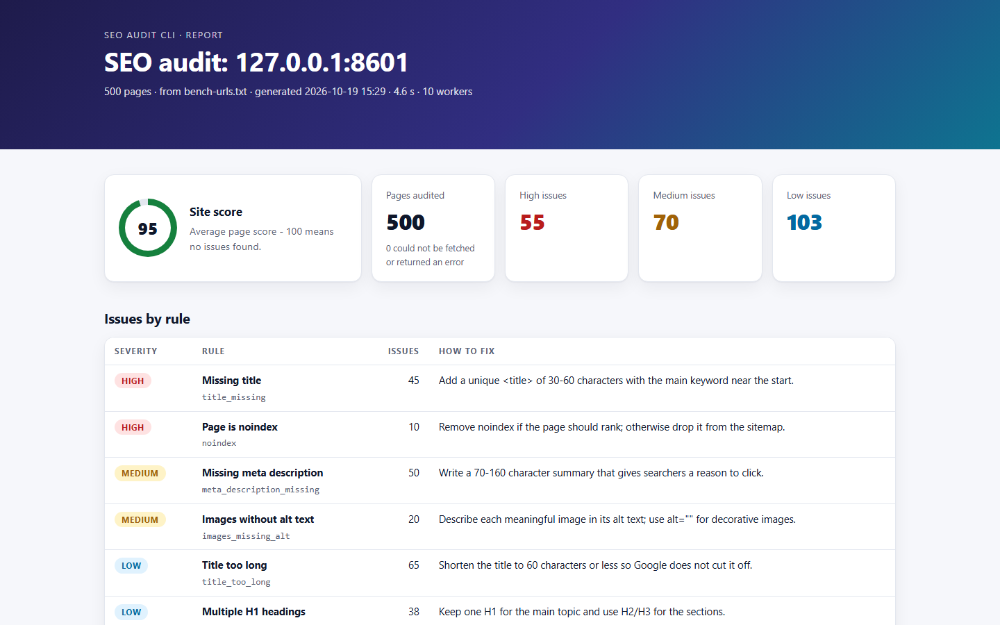

## Problem
An on-page audit is the first service most SEO clients buy. Checking titles, descriptions, headings, canonicals and indexability by hand takes hours for a few hundred pages, and a stray `noindex` is easy to miss.

## Approach
1. One small function per step — load URLs, fetch, check, report — each with its own tests.
2. Every SEO rule is its own function with a severity and fix advice, kept in one table, so the Excel and HTML reports always agree.
3. Sitemap and sitemap-index input, because that is how real sites (and every WordPress SEO plugin) list their pages.
4. A thread pool for speed: fetching is mostly waiting for the network, so threads overlap the waiting.
5. Polite by default: a clear User-Agent, robots.txt respected, an optional delay between requests.

## Key decisions
- **Threads, not asyncio** — the standard library's thread pool is enough for network-bound work and far easier to explain and maintain.
- **A score anyone can follow** — 100 minus 25, 10 or 3 points per high, medium or low issue, so a client understands why a page scores 72.
- **Network errors never crash the audit** — they become "fetch failed" issues, so one bad URL can't stop a 500-URL run.
- **A self-contained, escaped HTML report** — it opens offline, and a malicious page title can't run code in it.

## Results
| Measurement | Result |
|---|---|
| 500 URLs, 50 ms simulated latency per page (local test server, median of 3) | **34.0 s → 4.3 s** with 10 workers |
| 500 URLs, no added latency | 4.8 s → 4.1 s (parsing, not waiting, is the limit) |
| Planted problems on the 500-page test site | all found: 55 high, 70 medium, 103 low |
| Real audit of matt-g20.github.io | 5 pages, score 100 / 100, 0 issues |
| Automated tests | 70, all offline |

## Lessons
- Without network delay, threads barely help — the CPU is the bottleneck. Benchmark under realistic conditions before claiming a speed-up.
- Single timing runs mislead on a busy laptop (the first run took 14.8 s, later ones 4–5 s): report the median.
