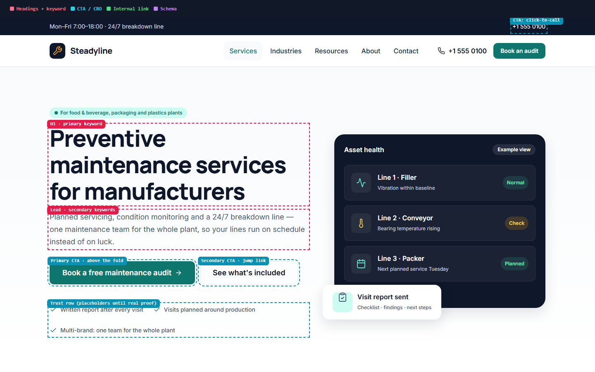

## Problem
Landing pages are usually designed first and "SEO'd" later: the H1 is a slogan, the keyword ends up in a footer paragraph and the FAQ has no schema. Fixing that after the design is approved means designing again.

## Approach
1. **Research before pixels** — a realistic B2B keyword (*preventive maintenance services for manufacturers*), its intent, and what the current top results do and miss.
2. **Wireframe with heading levels** — every section has its H1/H2/H3 and its job (answer an objection, explain the process, convert) before any visual design.
3. **High-fidelity design on my UI kit** — the same tokens and components the WordPress build uses.
4. **A page that documents itself** — every SEO element is labelled; `?annotate=1` draws the annotation map on the page for the client and the developer.
5. **Schema that can't drift** — one JSON-LD graph (ProfessionalService, Service, BreadcrumbList, FAQPage) and a check that every FAQ answer matches the page word for word.

## Key decisions
- **Exact keyword in the H1 and title; the audience in a small badge above it.** The title is 49 characters; adding the brand would make it 62.
- **"Free maintenance audit" as the main call to action** — most competing pages ask for a quote; a free audit is a lower-risk first step for a considered B2B purchase.
- **No fake proof** — the testimonials section is a clearly marked placeholder until a real client approves real words.

## Results
| Measurement | Result |
|---|---|
| Heading structure | 1 H1 with the exact keyword, 8 H2 sections |
| Keywords and questions mapped to sections | 15 |
| Schema types / FAQ answers matching the page | 4 / 6 of 6 |
| Lighthouse mobile, static prototype (local, median of 5) | performance **98**, accessibility **100**, best practices **100**, LCP 1.8 s, CLS 0 |

Rankings and conversions can only be measured once the page is built on a real domain.

## Lessons
- The first Lighthouse run caught what my own checks missed: low-contrast placeholder text, a skipped heading level and a missing favicon. Placeholders are text too.
- FAQ schema breaks silently when someone edits one sentence on the page. A 20-line check prevents it.
