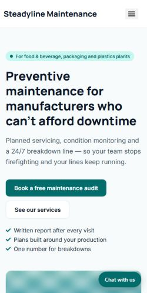
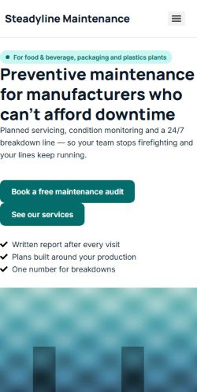

## Problem
"My WordPress site is slow" is the complaint I hear most, and most advice is a list of twenty fixes with no idea which ones matter. I wanted measurements: what each common fix does to a typical Elementor business site.

## Approach
1. **A deliberately heavy site, made by script** — my Elementor site kit plus what client sites usually carry: camera-size PNG photos shown at full size (16.4 MB), Google Fonts in every weight, Elementor's speed settings off, an addon pack's CSS on every page and a chat widget in `<head>`. Photos and stand-in scripts are generated, so there is no third-party code.
2. **One switch per step**, each rebuilding the whole site state, so every step is measured against the one before it.
3. **Proof before measurement** — after each switch, the page's HTML is checked for the change (WebP files, lazy loading, no Google Fonts…). A step that silently does nothing stops the run.
4. **Fair numbers** — a warm-up run, then 3 Lighthouse mobile runs per step; the median goes in the table.

## Results
Local lab, Lighthouse mobile, median of 3 runs (26 October 2026):

| Step (cumulative) | Score | LCP | Page weight |
|---|---:|---:|---:|
| Heavy baseline, no page cache | 34 | 81.1 s | 17.8 MB |
| + page cache | 65 | 80.9 s | 16.9 MB |
| + images resized, WebP | 77 | 4.1 s | 435 KB |
| + lazy-load below the fold | 77 | 4.1 s | 402 KB |
| + self-hosted fonts, swap | 74 | 3.6 s | 399 KB |
| + Elementor performance settings | 78 | 3.4 s | 266 KB |
| + unused CSS and JS removed | **84** | 3.2 s | 220 KB |
| + chat widget delayed | 81 | **3.1 s** | 239 KB |

## Lessons
- **Images are the whole story on photo-heavy sites.** Resizing and WebP cut LCP from 81 s to 4 s; no other step comes close. A page cache was the second big, cheap win.
- **A better step can make another metric look worse.** Faster fonts made text appear earlier, which moved the chat widget's blocking script into the window Total Blocking Time counts.
- **Measure the page, not the settings.** Two Elementor options from older tutorials no longer exist, and WordPress now converts the original upload when WebP is on. Only the HTML tells the truth.
